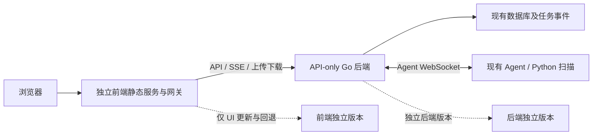

# 前后端解耦评估与方案

日期：2026-10-14；基线：本地 `feat/frontend-ui-redesign` / `c2c1854`。  
执行分支：`feat/frontend-backend-decoupling`（2026-10-15 从上述提交新建；基线记录保留）。  
状态：基于源码的评估与设计，尚未实施或进行分离部署验证。  
关联：[改造要求](../UI_design/01_UI改造要求.md)、[总计划](../UI_design/02_UI改造计划.md)、[解耦实施计划](02_前后端解耦实施计划.md)。

## 1. 结论与优先级

**现有平台达到源码目录分开和本地独立开发的程度，尚未达到前后端独立执行、构建、部署和发布的目标。**

因此先对现有平台解耦并保留现有界面，验收通过后再执行 UI 布局改造。本结论取代早期文档中“保留内嵌生产方式、独立部署不在本轮范围”的限制。

## 2. 检查依据

| 检查层面 | 实际实现与证据 | 判断 |
| --- | --- | --- |
| 源码目录 | React 位于 `frontend/`，Go API/任务位于 `common/websocket/`，Agent/Python 执行独立组织 | 已分目录，适合渐进改造 |
| API 通信 | 创建/查询/操作经 `/api/v1/app`，结果经 SSE，Agent 经 `/api/v1/agents/ws` | 已有接口边界，避免重写扫描业务 |
| 本地开发 | `frontend/vite.config.ts` 配置 5173 与 `VITE_DEV_PROXY_TARGET`，默认代理至 8088 | 可以分别启动开发服务 |
| 创建任务生命周期 | `task_manager.go` 的 AddTask 预存后等待 SSE，最多 100 秒；有连接才 dispatchTask 并返回 POST | 后端执行依赖前端观察连接，需要解除 |
| 事件持久化 | HandleAgentEvent 经 handleEvent 先 StoreEvent 后 SendEvent；无 SSE 时跳过发送，后续终态处理继续 | 已有脱离浏览器保存事件的基础，但须测试确认 |
| 静态资源 | `server.go:44` 的 `go:embed static/*`，NoRoute 读取嵌入 index.html 作为 SPA 回退 | API 服务与产品 UI 资源耦合 |
| Docker 构建 | Dockerfile 先构建前端，再 COPY dist 到 Go static 后编译 | 后端镜像依赖前端构建，UI 更新要求重建后端 |
| 部署与健康检查 | Compose 提供 webserver + agent；webserver 的 `/` 同时承担 UI 入口与健康探测 | 缺少独立前端服务和独立 API 健康检查 |
| 配置与请求层 | VITE_API_BASE_URL 固定空字符串；相对 URL 与 fetch/EventSource/XHR 分散于页面、Context、lib | 默认同源可行，网络边界和配置未集中 |
| 发布渠道 | docker-publish 基于同一 Dockerfile；create-release 拷贝现有双服务 Compose，离线升级也假定旧布局 | 需提供分离构建与版本/升级记录 |

API Checker 在 `common/apichecker/proxy.go` 仅代理 relay API、文档及健康路径；不是主 SPA。后端 Swagger/OpenAPI 文档可以继续存在，不等同于产品 UI 内嵌。

本次属于代码与配置检查。没有启动新的分离服务，也没有用已有一体化构建成功推断新架构已经可用。

## 3. 解耦目标

### 3.1 独立产物和运行

- 前端构建只需要前端工具链，产出 dist 和独立静态服务镜像，不需要 Go、Agent 或扫描运行时。
- 新生产后端采用 API-only 构建，不依赖 frontend 源码、Node、dist 或产品 static 资源。
- 前端镜像与后端镜像可以各自更新、版本化和回退；UI 更新不改变运行中的后端镜像和数据库。
- 新分离部署成为后续改造的默认交付方式。旧一体化构建只作为明确标识的兼容渠道，不用运行时开关冒充编译层解耦。
- 使用同一仓库不会妨碍解耦；本期不需要拆成多个 Git 仓库。

### 3.2 后端执行不依赖浏览器

创建任务仍使用现有 POST、sessionId、参数、响应格式和模型解析逻辑，但去掉等待 SSE 的前置条件：校验 → 持久化 → 使用现有 dispatchTask 分发 → 返回创建结果。

第一阶段不引入新队列或“先成功接受、稍后可能分发失败”的新语义：创建成功仍代表现有分发流程成功；无 Agent、无效模型或分发失败继续返回业务失败并按既有方式清理。后端任务持续执行与事件存储不依赖是否有浏览器订阅。

不能直接用 AddTaskApi 代替 AddTask：两条链路的模型参数增强、内存登记、分发和清理不同，必须复用原 AddTask 的真实业务链路，只解除 SSE 门槛。

### 3.3 SSE 成为可选观察通道

- 后端先保存事件，再尝试实时通知；无订阅、断线或切页不影响执行、终态保存与资源清理。
- 旧 UI 在本阶段同步适配晚订阅：创建成功后可订阅，同时读取真实任务详情；每次重连成功再对账快照。
- 在订阅建立到快照读取之间暂存/合并实时事件，按持久化事件标识去重，保留详细错误；不能以清空状态再装快照覆盖较新的终态。
- 快任务可能在订阅前完成，此时详情接口必须恢复结果；已结束任务不建立无限存活的新订阅。
- 保留现有状态轮询补偿；不假设当前 SSE 已实现 Last-Event-ID 自动重放。
- 网络错误导致 POST 结果不确定时先查询同一 sessionId，不能直接再次提交生成重复任务。

实施前审阅补充（2026-10-14）：

- 保存事件与终态处理不能被慢订阅拖住。当前 `handleEvent` 同步调用 `SendEvent`，`HandleAgentEvent` 随后才更新终态；实施需给推送设置有界等待，并测试阻塞写入时终态和其他任务仍可处理。异步通知如有必要，只作为可丢弃的观察通道，不改变任务分发语义。
- 重连清理必须校验连接身份。当前按 sessionId 替换和删除连接，旧 HTTP 请求结束可能误删新连接；实施需使关闭操作幂等，并明确同一任务多标签页的订阅策略。
- POST 返回未知时，查到预存记录只证明任务记录存在，不能证明分发成功；assigned_agent 同样在模型增强和发送前更新，不能单凭该字段确认成功。需要围绕同一 sessionId 对账真实执行事件、终态、明确不存在和查询异常；原请求仍在处理或状态不可判定时保持“提交结果待确认”，不得自动再次创建。详情查询需要可区分不存在、无权限与服务故障，API 文档同步记录行为变化。

解耦阶段的基线、计划、审阅、验收和迁移记录统一保存在 `docs/System_Split`；UI 文档引用这些记录，共享代码仍在原业务目录修改。

## 4. 部署方案比较

| 方案 | 特点 | 选择 |
| --- | --- | --- |
| 独立前端静态服务/网关 + API-only 后端 | 构建、运行和更新独立；浏览器使用同源 `/api`，网关配置后端地址 | 推荐作为本期目标 |
| Go 从外置目录读 dist | UI 文件可替换，但同一进程仍承担产品 UI 服务，独立镜像/运行边界不足 | 不作为目标架构 |
| 前后端直接跨域 | 可独立部署，但需全面处理 CORS、Cookie、SSE/XHR 凭据及来源策略 | 后续确有需求时扩展，本期不强制 |

同源是一种通信方式，不等于前后端必须是同一服务。前端服务通过可配置 upstream 连接后端，可以在不同容器乃至不同主机运行。

## 5. 构建和静态资源边界

建议将 server.go 中的产品静态资源代码移到条件编译文件：`static_embedded.go` 仅参与兼容构建，`static_api_only.go` 参与 `api_only` 构建。公共 server.go 不再直接声明 embed 或读取产品资源。

后端生产 Dockerfile 使用 `go build -tags api_only`；需要验证在构建上下文完全没有 `frontend/` 和 `common/websocket/static/` 时依然成功。单纯不调用静态 handler、但仍编译 embed 的方案不达标。

前端 Dockerfile 只负责前端构建与静态服务。构建只从 `frontend/` 取上下文，资源和帮助文档继续随 dist 分发。Nginx 等静态网关版本在实施时锁定并记录，不为 UI 引入新的云服务。

API-only 模式的未知 API 与未知产品页面返回真正的 404，不回退 index.html；SPA 路由回退仅由前端服务负责。Swagger/OpenAPI 和 API Checker 的已注册文档/健康路由保留。

后端增加独立 `/healthz` 存活探测，前端有独立静态服务探测；二者的健康不能代替 Agent 注册及真实任务可执行性检查。

## 6. 网关与配置要求

- API upstream 在部署时配置，不将服务内网地址硬编码到页面，也不要求改 upstream 时重新编译 UI。
- 前端所有 API URL 经公共构造器处理；fetch、EventSource、XHR、文件下载和 relay stream 保持一致的根路径规则。
- 默认同源；网关保留路径、查询、Cookie 及所需身份头，不绕过现有身份和模型凭据解析。
- `/api/v1/app/tasks/sse/`、`/api/v1/relay/check/stream` 关闭响应缓冲和相关缓存，保留流式刷新并配置合适读超时；上传保留现有大小、分片和超时要求。
- Agent 默认连接内部后端地址；经过网关的 WebSocket 路径仍应支持 Upgrade，避免旧客户端连接方式失效。
- `/api/`、`/api-checker`、`/docs/` 先转发后端，不能匹配前端 SPA fallback；`/llm` 按基线确认的现有消费者与路由保留，不凭 Vite 配置推测它必然有后端服务。
- 分离部署不需要增加宽泛 CORS。将来选择直接跨域时，须统一来源、凭据与 SSE/XHR 行为，不只设置 SSE 的允许来源头。
- 反向代理升级不能删除现有数据卷、规则目录、上传目录和 API Checker 数据卷。

## 7. 第一阶段验收门槛

| 编号 | 达标证据 |
| --- | --- |
| D01 | 无前端源码/产品 static/Node 的后端构建成功，API-only 产物不服务产品 HTML |
| D02 | 仅前端上下文构建成功，前端服务在后端不可用时仍能返回静态页面 |
| D03 | 不建立 SSE 也能通过任务 POST 完成现有分发，Agent 执行后历史状态和结果可查询 |
| D04 | 任务运行时关闭/重启前端服务，任务与事件仍保存；重新进入可恢复早期日志、详细错误和结果 |
| D05 | 快任务在订阅前完成、重连对账、重复事件、POST 结果不确定等场景无丢失或重复提交 |
| D06 | 上传、下载、报告旧地址、规则/模型/Agent 管理、relay 流式接口和 WebSocket 均经新边界可用 |
| D07 | 仅替换前端版本，后端/Agent 镜像标识和数据保持不变；前端可独立回退 |
| D08 | 分离 Compose、健康检查、离线镜像清单、发布构建和升级说明一致，旧版本包不被覆盖 |
| D09 | 新增任务流程相关行为已同步 API 文档；基线失败和未验证模块分别记录 |

D01–D09 通过后才开始工作台布局迁移。任务名称、模型配置、六类历史兼容和真实扫描范围不随本阶段变化。
