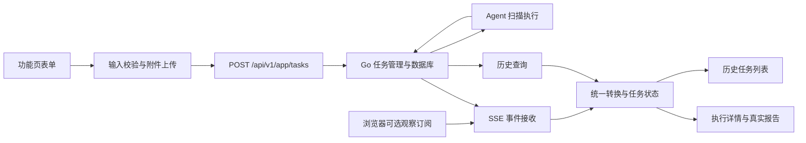

# 前端 UI 改造说明

日期：2026-10-14；工作分支：`feat/frontend-ui-redesign`。  
状态：改造前的设计与迁移说明，尚未实施；不是完成报告。  
配套：[UI 改造要求](01_UI改造要求.md)、[UI 改造计划](02_UI改造计划.md)。

新增前置：[前后端解耦评估与方案](../System_Split/01_前后端解耦评估与方案.md)、[解耦实施计划](../System_Split/02_前后端解耦实施计划.md)。当前未达到独立构建、发布和无浏览器执行目标，先完成平台解耦，再改工作台布局。

## 1. 改造思路

将当前以聊天、任务侧栏和结果面板为主的界面，调整为以检测功能为中心的工作台。左侧切换功能，右侧上方配置并发起任务，下方查看该功能历史；选中任务可查看执行详情和结果。

借鉴原型的页面组织和视觉层级，使用现有项目的真实功能、字段、API 和报告。导航与任务类型属于不同概念：入口决定用户正在使用哪种功能，任务类型决定请求和结果如何处理。

## 2. 现状与耦合边界

| 层面 | 当前实现 | 本轮处理 |
| --- | --- | --- |
| 前端源码 | `frontend/`，React 18 / Vite 6 / Tailwind 3 | 在此目录改造，保留技术栈 |
| API | `common/websocket/server.go` 注册 HTTP 路由 | 复用现有协议 |
| 任务状态与数据 | Go TaskManager 与 SQLite/GORM；创建任务等待 SSE | 保留持久化来源，解除创建的观察连接门槛 |
| 扫描执行 | Agent 通过 WebSocket 领取任务并回传事件 | 保留现有扫描能力 |
| 浏览器实时结果 | SSE 与任务状态轮询 | 作为可选观察通道，增加晚订阅/重连快照对账 |
| 本地开发 | Vite 5173 代理 API 至 Go，默认 8088 | 继续独立开发和联调 |
| 生产发布 | dist 复制到 Go static 后编译嵌入 | 第一阶段改为独立前端/API-only 后端，旧一体化渠道仅兼容 |

当前可以分开开发前后端，但不是完全独立发布。`Dockerfile` 的前端构建阶段输出 dist，Go 阶段复制到 `common/websocket/static/`；`server.go` 使用 `go:embed static/*`。因此更新生产 UI 需要更新 webserver 构建产物。

浏览器请求主要为同源相对路径；`env.VITE_API_BASE_URL` 当前固定为空字符串。主服务未启用全局 REST CORS，SSE 单独设置允许来源头，不能据此认为全部 API 已支持直接跨域。本期以独立前端静态服务/网关维持同源通信，在部署时配置 API upstream；独立服务不要求直接跨域。

## 3. 前端内部的迁移重点

| 现有文件 | 当前责任 | 改造方式 |
| --- | --- | --- |
| `components/ChatArea.tsx` | 表单状态、附件上传、参数构造、提交、SSE、交互消息 | 抽出请求/上传/提交/订阅；表单进入各功能页，追加交互进入详情 |
| `components/TaskSidebar.tsx` | 历史任务、搜索、编辑、删除、终止等 | 历史迁入功能页下方，操作复用 taskApi |
| `context/AppContext.tsx` | 全局任务状态、历史加载、事件解析与轮询 | 保留单一状态源，转换与网络请求委托独立模块 |
| `components/App.tsx` | 主布局、选中步骤/结果、路由 | 改为工作台与详情容器，保留已有辅助/报告地址 |
| `components/detailPanel/` | 各引擎结果、打印及报告展示 | 继续复用，以结果类型选择对应组件 |
| `components/management/`、`lib/*Api.ts` | 模型、Agent、规则、评测集等管理 | 迁移入口，保留已有业务 |
| `config/privateModules.tsx` | 私有 overlay 的桥接契约 | 保留 AppShell/AuthGate 与扩展能力 |

提取顺序很重要：第一阶段先让旧页面复用抽出的逻辑，适配无浏览器也能执行的后端与快照恢复，并验证独立产物，再让新页面接入。否则可能出现新旧两套 SSE、不同状态转换以及不同请求字段。

## 4. 新页面组织建议

建议的新增模块位于 `frontend/src/components/workbench/`，以以下责任划分：

- `WorkbenchLayout`：左侧导航和右侧内容的整体布局。
- `FunctionSidebar`：功能入口与辅助入口，使用当前可用服务配置。
- `EvaluationPage`：标题、上方发起区和下方历史区的统一结构。
- `forms/*Form`：每种任务的具体表单，共享基础控件但保留独有参数。
- `TaskHistoryTable`：当前已加载历史的搜索状态、筛选、分页和任务操作。
- `TaskHistoryPage`：全类型历史，提供兼容任务的访问路径。
- `TaskDetailDrawer`：当前选中任务的执行与结果容器，复用时间线和结果组件。

详情抽屉、默认入口和 `/workbench/...` 路由属于初版设计建议；后续可以调整具体表现，只要保留已确认的工作台结构与功能可达性。

## 5. 真实任务数据流

### 提交与显示

1. 表单使用现有任务规则校验并上传文件；失败时保留输入。
2. 解耦后的后端创建不等待 SSE：构造现有请求体与 sessionId 并 POST，业务成功才确认分发；占位不代表已接受。
3. 浏览器作为观察者订阅 SSE 并查询历史详情进行快照对账，恢复订阅前的日志/结果；实时事件与快照合并，不覆盖较新终态。明确的业务失败清理占位，网络返回未知时先查询同 sessionId，再决定恢复或重试。
4. 服务端持久化任务和事件；刷新时通过列表/详情接口恢复。
5. SSE 缺失终态时保留现有状态轮询补偿。

旧版本限制：AddTask 预存后等待 SSE，100 秒无连接会清理任务；这正是第一阶段要解除的流程耦合。后端解耦完成前，过渡旧 UI 仍需 POST 在途并行建 SSE；后端完成后改用无门槛创建和快照恢复。不能把两套时序同时当作新架构要求。

后端 raw 状态包含 `todo/doing/done/error/terminated`；前端已有 `pending/running/completed/done/error/terminated` 等表示。新页面必须经统一适配显示，不能引入原型的 `SCANNING/COMPLETED` 枚举直接替代协议。

## 6. API 与上传约束

| 用途 | 现有接口 |
| --- | --- |
| 查询任务 | `GET /api/v1/app/tasks`，现有搜索参数为 `q`、`taskType` |
| 创建任务 | `POST /api/v1/app/tasks` |
| 任务详情 | `GET /api/v1/app/tasks/:sessionId` |
| 修改、删除任务 | `PUT/DELETE /api/v1/app/tasks/:sessionId` |
| 终止任务 | `POST /api/v1/app/tasks/:sessionId/terminate` |
| 分享任务 | `POST /api/v1/app/tasks/share` |
| 普通上传 | `POST /api/v1/app/tasks/uploadFile` |
| 分片与合并 | `POST /api/v1/app/tasks/uploadChunk`、`mergeChunks` |
| 附件下载 | `POST /api/v1/app/tasks/:sessionId/downloadFile` |
| 实时任务事件 | `GET /api/v1/app/tasks/sse/:sessionId` |

当前任务列表接口没有已核验的服务器分页参数；初期分页只处理返回集合。增加服务端分页需作为单独接口变化评估。

现有上传实现存在差异：`ChatArea.tsx` 使用与 Go handler 对应的 `fileId/filename/chunk` 及独立合并；`utils/uploadUtils.ts` 使用 `uploadId/fileName/file` 并依赖末片返回最终地址。迁移须以生效调用链与后端为准，不仅凭文件名选择复用代码。

创建请求保持 `id/sessionId/taskType/timestamp/content/params/attachments/countryIsoCode`。模型、评分模型、Agent、Header、数据集、攻击方法和端口模式的构造依赖任务类型，须在迁移前记录和测试。本文没有要求统一所有任务的参数语义。

## 7. 功能保留与原型差异

- 当前五个发起入口独立展示；`Model-Jailbreak` 保留历史和结果兼容，默认不新增发起能力。
- 原型的 `CLAW` 无同名现有任务，不据此新增扫描引擎。
- 原型的预设 CVE 数量、漏洞摘要、置信度与补丁不能作为真实数据源。
- 现有结果包含消息、步骤、工具调用及不同引擎结果；新列表摘要只是显示适配，原始信息继续保留在详情。
- 原型中的按钮只有在现有功能支持时才接入；没有实现的功能不显示成可用操作。
- 移除主聊天布局前必须迁移已有追加交互，不能只保留“发起一次、查看一次”。

## 8. 实施与回退

1. 保持 `feat/frontend-ui-redesign` 为本轮工作分支，先执行平台解耦计划并验收。
2. 第一阶段旧 UI 使用公共逻辑并适配可选观察链路，第二阶段迁移工作台布局；切换后再清理无消费者旧代码。
3. 每阶段提交只包含本轮解耦与 UI 改造相关文件，保留工作区既有无关离线升级改动，不把它们夹带提交。
4. 数据与响应形状优先兼容，创建生命周期和静态路由变化明确记录；新 UI 与解耦后端分开版本化，回退按各自已验证产物进行。
5. 第一阶段后 UI 更新只替换前端产物；后端/Agent 镜像与数据库无需随 UI 重建。旧一体化部署作为兼容渠道单独标记。

回退验证须包括旧 UI 读取新期间产生的任务和报告，不以“没有数据库迁移”代替兼容测试。

## 9. 文档更新方式与当前证据

前后端解耦文档统一存放在 `docs/System_Split`，本目录只保存 UI 改造文档。后续在本目录补充 `04_功能与接口基线.md`、`05_UI改造验收记录.md`，并在 `docs/System_Split` 补充 `03_前后端解耦验收记录.md`；这些是计划产出，当前未生成。需求变化先更新要求，再同步计划和说明。阶段记录提交、影响文件、环境、证据和未验证项。

2026-10-13 对现有项目的基线检查：14 项前端测试与 TypeScript 检查通过。该结果不代表尚未实施的新工作台通过验收。原型仓库的构建结果也不能作为当前项目的验收证据。

当前已编写/更新五份 UI 与解耦文档，未变更前后端业务代码、部署配置或数据；不能将方案写成已经完成解耦。
